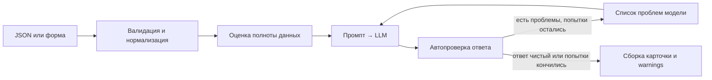

# AI-помощник для подготовки карточек товаров КИП

Прототип сервиса, который по данным о контрольно-измерительном приборе готовит черновик карточки для B2B-интернет-магазина: SEO-заголовок, SEO-описание, таблицу ключевых характеристик, поисковые запросы и блок для менеджера. Главный принцип — модель не выдумывает характеристики: всё, что попадает в карточку, сверяется с входными данными, а чего не хватает, помечается как «данных нет» и выносится в список «Что уточнить».

Работает с любой LLM через OpenAI-совместимый API (OpenAI, DeepSeek, OpenRouter, локальная Ollama и т. д.). Есть CLI и простая веб-форма.

## Быстрый старт

Нужен Python 3.10+.

```bash
git clone <ссылка на репозиторий>
cd product-card-assistant
python -m venv .venv
source .venv/bin/activate
pip install -r requirements.txt
cp .env.example .env
```

На Windows вместо `source .venv/bin/activate` — `.venv\Scripts\activate`, вместо `cp` — `copy`.

В `.env` достаточно заполнить три строки: адрес API, ключ и модель. Готовые варианты для OpenAI, DeepSeek, OpenRouter и Ollama есть в `.env.example`. API-ключ хранится только в `.env`, который не попадает в git.

```bash
# одна карточка — Markdown в консоль
python -m card_assistant generate examples/input/manometer_tm510.json

# все примеры — в папку (на каждый товар .json и .md)
python -m card_assistant generate examples/input/*.json -o examples/output

# веб-форма на http://127.0.0.1:8000
python -m card_assistant serve

# входной JSON из оффера YML-фида souz-pribor.ru
python -m card_assistant from-feed 191953 -o my_product.json
```

Коды выхода CLI: `0` — всё готово, `1` — часть файлов не обработана (ошибки выведены, остальные файлы сохранены), `2` — ошибка входных данных или настроек, `3` — ошибка LLM API (ключ, сеть, квота).

## Какую модель выбрать

| Провайдер | `LLM_BASE_URL` | Пример `LLM_MODEL` |
|---|---|---|
| OpenAI | `https://api.openai.com/v1` | `gpt-4.1-mini` |
| DeepSeek | `https://api.deepseek.com` | `deepseek-chat` |
| OpenRouter | `https://openrouter.ai/api/v1` | `openai/gpt-4.1-mini` |
| Ollama (локально, без ключа) | `http://localhost:11434/v1` | `qwen2.5:14b` |

Чем сильнее модель, тем реже нужны повторные попытки: небольшие локальные модели хуже держат объём 800–1200 символов и чаще получают предупреждения автопроверки. Если модель не принимает `temperature` или `response_format` (так бывает у reasoning-моделей и части локальных), клиент сам повторит запрос без этих параметров.

## Входные данные

```json
{
  "name": "Манометр показывающий DM 02",
  "manufacturer": "Манотомь",
  "specs": {
    "диапазон измерений": "0–1,6 МПа",
    "класс точности": "1,5"
  },
  "description": "Прибор предназначен для измерения избыточного давления..."
}
```

Обязательно только `name`. Характеристики принимаются в нескольких видах, потому что так они приходят на практике:

- объект `{"название": "значение"}`;
- вложенный объект для строк таблицы с подпунктами — `{"Погрешность": {"ТС": "0,25 %", "ТП": "0,5 %"}}` превращается в «Погрешность — ТС» и «Погрешность — ТП»;
- список пар `[["IP", "IP65"]]` или объектов `[{"name": "...", "value": "..."}]`;
- текст «название: значение» по строкам — так их вводят в веб-форме.

Числа, `null` и списки в значениях допускаются. Дополнительные поля (`category`, `source`, `url`…) не мешают: `category` передаётся модели как контекст, остальное сохраняется в `meta` результата. Битый JSON, не тот тип данных или пустое название дают понятную ошибку с указанием поля, строки и столбца.

## Результат

Каждая карточка сохраняется в двух видах: JSON для загрузки в CMS и Markdown для чтения и копирования. В веб-форме у каждого блока есть кнопка «Копировать».

| Поле | Что внутри |
|---|---|
| `seo_title` | заголовок до 70 символов |
| `seo_description` | описание 800–1200 символов, 2–3 абзаца |
| `key_specs` | характеристики с источником: `specs`, `name` (из названия модели), `description` или `missing` со значением «данных нет» |
| `search_queries` | 3–5 запросов |
| `commercial` | кому подходит прибор (`audience`) и какие задачи решает (`tasks`) |
| `clarifications` | что уточнить у поставщика: пустые поля, неоднозначные значения серии, противоречия |
| `warnings` | что не прошло автопроверку после всех попыток |
| `status` | `ok` — черновик готов к вычитке; `needs_review` — есть предупреждения; `insufficient_data` — исходных данных слишком мало |

## Как устроено



| Модуль | Назначение |
|---|---|
| `schemas.py` | входная модель, нормализация характеристик, схема ответа модели и результата |
| `checks.py` | оценка полноты входа и все детерминированные проверки ответа |
| `prompts.py` | системный промпт, пользовательское сообщение, сообщение для исправления |
| `llm.py` | клиент OpenAI-совместимого API и понятные сообщения об ошибках |
| `generator.py` | цикл «генерация → проверка → исправление» и финальная сборка |
| `render.py` | Markdown-версия карточки |
| `feed.py` | оффер из YML-фида → входной JSON |
| `web.py`, `static/index.html` | FastAPI и веб-форма без сборки и внешних зависимостей |

## Как сервис не даёт модели выдумывать

Одного запрета в промпте мало, поэтому защита многослойная.

**Промпт.** Модель получает явные правила: сведения только из входных данных; не пересчитывать единицы (кгс/см² в МПа) и не округлять; не переносить свойства похожих приборов и других модификаций серии; если для параметра перечислено несколько вариантов серии и по названию модель не определить — писать «в зависимости от исполнения» и выносить вопрос в `clarifications`; противоречия не исправлять, а описывать; цену, наличие и магазин не упоминать; при нехватке фактов писать коротко, а не раздувать текст.

**Характеристики — не свободный текст.** Для каждой характеристики модель указывает источник и `evidence`: точный ключ из `specs` или дословную цитату из названия или описания. Код проверяет, что ключ существует, а цитата действительно есть во входных данных и подтверждает значение. Если модель переписала значение из `specs`, в карточку попадает исходное. Выбрать один вариант из серийного перечня (например, «1,5» из «1,5; 1,0») можно, только если он явно записан в названии модели — как резьба G1/2 в «ТМ-510Р.00(0-2,5 МПа)G1/2». Неподтверждённые характеристики отбрасываются.

**Сверка чисел с единицами.** Все публикуемые тексты (заголовок, описание, запросы, блок для менеджера) проверяются на числа, которых нет во входных данных, причём вместе с единицами измерения. Проверки одних чисел недостаточно: у манометра выдуманный «выход 4–20 мА» проходит её, потому что 4 и 20 во входных данных есть (в перечне диапазонов и в резьбе M20x1,5). Пара «20 мА» во входных данных отсутствует, и проверка её ловит.

**Рискованные сведения.** Гарантия, сертификаты, поверка, ГОСТ, взрывозащита, интерфейсы (RS-485, Modbus, Wi-Fi, USB, HART…) и материалы (нержавеющая сталь, латунь) допускаются, только если они есть во входных данных. Цена, наличие, доставка и магазин запрещены всегда, даже если встречаются в исходном описании.

**Цикл исправлений.** Найденные проблемы отправляются модели конкретным списком («seo_title: 92 символа при лимите 70», «значения 20 мА не найдены во входных данных»), до двух раз. Если ответ всё ещё не чистый, сервис не дописывает ничего от себя: слишком длинный заголовок обрезается по смысловой границе, описание — по концу предложения, а всё оставшееся попадает в `warnings`, и карточка получает статус `needs_review`.

**Нехватка данных.** До вызова модели код сам проверяет полноту входа: нет производителя, характеристик или описания, есть пустые значения. Это попадает в `clarifications`. Пустые значения и важные для такого типа прибора характеристики, которых нет во входе, выводятся в таблице со значением «данных нет». Если данных совсем мало, модели разрешено написать описание короче 800 символов, а карточка получает статус `insufficient_data`.

## Промпты

Все промпты — в [`card_assistant/prompts.py`](card_assistant/prompts.py).

- **Системный промпт** задаёт роль (технический редактор B2B-магазина КИП), главное правило, список запретов, правила работы с сериями, модификациями и противоречиями, точную JSON-структуру ответа и требования к каждому полю с лимитами.
- **Сообщение пользователя** содержит данные о товаре в JSON и результат автоматической проверки входа, чтобы модель заранее знала, чего не хватает. При очень скудных данных добавляется явное разрешение на короткое описание.
- **Сообщение для исправления** перечисляет найденные проблемы и напоминает ограничения. Модель видит свой прошлый ответ и правит его, а не пишет с нуля.

Принятые решения:

- Промпт на русском: карточки русскоязычные, а в отраслевых формулировках (класс точности, избыточное давление, щитовой корпус) важна точность терминов.
- JSON-режим API и `temperature` 0.2: для карточек нужна предсказуемость, а не разнообразие.
- Поле `evidence` в схеме ответа: требование ссылаться на источник само по себе снижает количество выдумок, а для кода это ещё и основание для проверки.
- Лимиты длины — в коде, а не только в промпте: модели плохо считают символы, поэтому код меряет длину и возвращает модели точную цифру.

## Примеры

Входные данные — в `examples/input`, результаты — в `examples/output` (в конце каждого файла указана модель, которой он сгенерирован).

| Файл | Товар | Что проверяет |
|---|---|---|
| `manometer_tm510.json` | Манометр РОСМА ТМ-510Р.00(0-2,5 МПа)G1/2 | Характеристики общие для серии: класс точности «1,5; 1,0», диапазоны в кгс/см², а в названии — МПа. В описании стекло «минеральное», в характеристиках — «инструментальное». |
| `thermoregulator_trm500.json` | Терморегулятор ОВЕН ТРМ500-Щ2.30А | Таблица характеристик общая для трёх модификаций: у «Выхода 1» разные значения для 5А и 30А. В описании серии есть Wi-Fi и OwenCloud, которые относятся к модификации ТРМ500-Щ2.WiFi. «Выход 2» в характеристиках — 3 А, в описании — до 5 А. Нет диапазона измерений и степени защиты. |
| `feed_only_pd100.json` | Датчик давления ОВЕН ПД100-ДИ1,6-111-0,5 | Только данные из фида — характеристик и описания нет. Ожидаемый статус — `insufficient_data`. |
| `broken_input.json` | — | Битый JSON (лишняя запятая): понятная ошибка, остальные файлы обрабатываются. |

### Откуда данные

Товары выбраны из фида `https://www.souz-pribor.ru/yml/any/feed.xml` (47 982 оффера на 04.11.2026). В фиде у офферов нет ни описания, ни технических характеристик — только название, тип, производитель, цена и учётные коды. Поэтому характеристики и описание для двух основных примеров перенесены без изменений со страниц товаров на сайте; источник и пояснение лежат в поле `source` каждого файла. Пример `feed_only_pd100.json` собран командой `from-feed` и показывает, что делает сервис, если взять только данные фида.

Что ещё бросилось в глаза в данных: многие офферы ведут на одну общую страницу серии (все модификации ПД100 — на одну карточку), поэтому характеристики со страницы описывают серию, а не конкретную модификацию. Кроме того, в фиде встречаются дубли: ТРМ500-Щ2.30А с одним артикулом есть под id 72972 и 229565 с разными `typePrefix` и разными URL.

## Тесты

```bash
pip install -r requirements-dev.txt
pytest
```

Тесты не ходят в сеть: вместо LLM подставляется заглушка с заранее заданными ответами. Покрыты нормализация и валидация входа, оценка полноты, проверки чисел, единиц, терминов и характеристик, цикл исправлений (проблемы действительно уходят модели), обработка битого JSON от модели, деградация в `warnings`, ошибки LLM API (401, 404, 429, 500, обрыв связи, пустой ответ, неподдерживаемые параметры), веб-API, CLI и конвертер фида.

## Ограничения и что можно улучшить

- **Проверки эвристические.** Числа с единицами, термины и цитаты ловят основные виды выдумок, но не все: модель может приписать прибору качественное свойство без чисел и терминов из списка («подходит для агрессивных сред»). Следующий шаг — второй проход LLM-судьи, который разбивает текст на утверждения и для каждого ищет подтверждение во входных данных.
- **Серия и модификация.** Сервис определяет модификацию по названию модели и явным пометкам. Надёжнее получать от поставщика или из учётной системы структурированные данные по каждой модификации.
- **Источник характеристик.** Сейчас характеристики для примеров перенесены со страниц вручную. Для каталога нужен парсер страниц товаров или PDF-паспортов (ссылки на документацию на сайте есть).
- **Масштаб.** Для десятков тысяч офферов нужны пакетная обработка с очередью, ограничение частоты запросов, кэш и учёт стоимости.
- **SEO.** Поисковые запросы придумывает модель, без данных о частотности; их стоит сверять с Яндекс Вордстатом.
- **Стиль магазина.** Не было редполитики и примеров эталонных карточек. С ними можно добавить few-shot-примеры и проверки тона.
- **Оценка качества.** Для выбора модели и правок промпта нужен эталонный набор карточек и метрики: доля выдуманных значений, соблюдение длины, число повторных попыток, доля `needs_review`.

## Структура проекта

```
card_assistant/      код сервиса
  static/index.html  веб-форма
examples/input/      входные данные примеров
examples/output/     сгенерированные карточки (.json и .md)
tests/               тесты и фрагмент реального фида
.env.example         шаблон настроек
```
